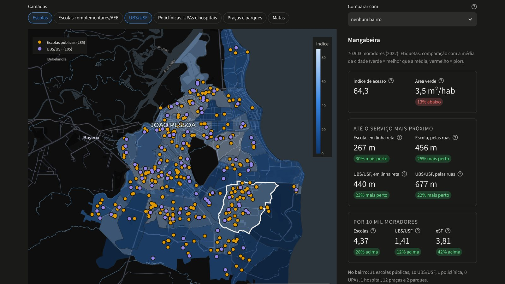
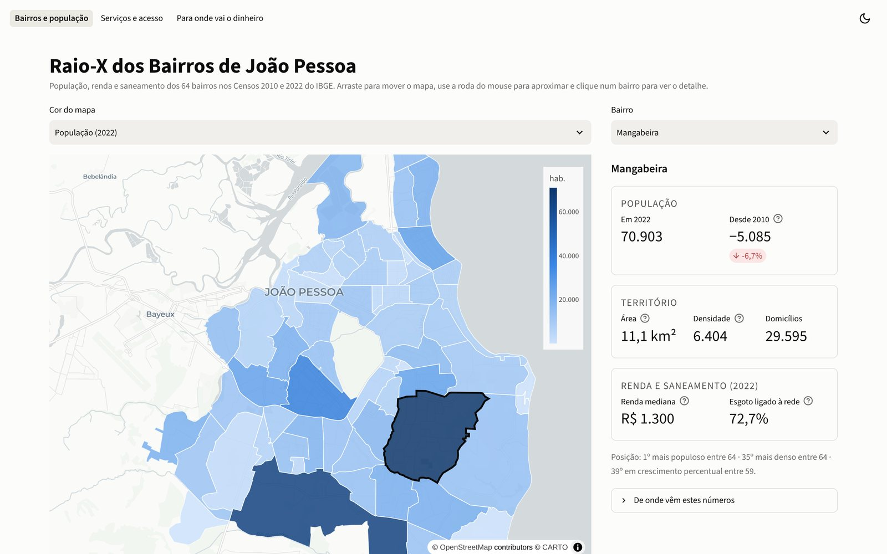
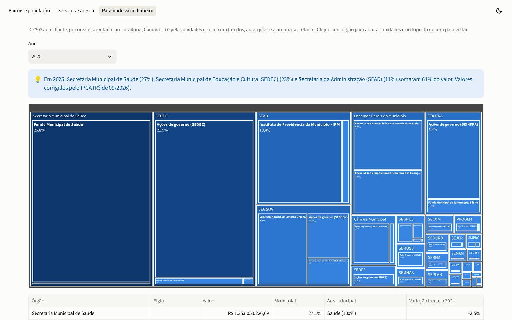
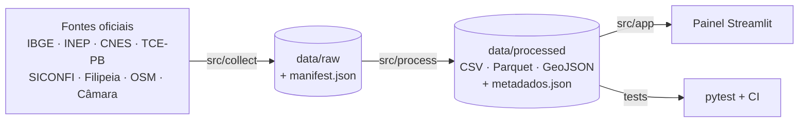

<div align="center">

# Raio-X dos Bairros de João Pessoa

**Painel aberto com dados públicos sobre os 64 bairros de João Pessoa (PB):
população, acesso a serviços públicos e gasto municipal.**

[](https://raio-x-joao-pesoa.streamlit.app/)
[](https://github.com/davialves1820/RaioX-Joao-Pessoa/actions/workflows/testes.yml)


**[Acessar o painel →](https://raio-x-joao-pesoa.streamlit.app/)**



</div>

---

## Sumário

- [Sobre o projeto](#sobre-o-projeto)
- [O que o painel mostra](#o-que-o-painel-mostra)
- [Princípios](#princípios)
- [Fontes de dados](#fontes-de-dados)
- [Como rodar](#como-rodar)
- [Arquitetura](#arquitetura)
- [Qualidade e testes](#qualidade-e-testes)
- [Usar os dados](#usar-os-dados)
- [Documentação](#documentação)
- [Créditos e licenças das fontes](#créditos-e-licenças-das-fontes)

## Sobre o projeto

O **Raio-X dos Bairros de João Pessoa** reúne num só lugar dados oficiais que hoje estão espalhados
por IBGE, INEP, Ministério da Saúde, TCE-PB, Tesouro Nacional, Prefeitura e Câmara Municipal, e os
organiza por bairro. O objetivo é responder perguntas concretas sobre a cidade: quantas pessoas moram
em cada bairro e como isso mudou, quanto quem mora ali anda até a escola pública ou a UBS mais próxima,
e para onde vai o dinheiro dos órgãos municipais.

Cada número do site pode ser rastreado até o arquivo de origem, com URL, data de download e SHA-256
registrados em [`data/raw/manifest.json`](data/raw/manifest.json). Fontes e limitações aparecem no
próprio painel, ao lado dos números.

## O que o painel mostra

### Bairros e população



- População nos Censos 2010 e 2022, variação no período e densidade.
- Renda mediana do responsável pelo domicílio e domicílios com esgoto ligado à rede (Censo 2022).
- Bairros que mais cresceram e mais perderam moradores, só entre os que têm limites comparáveis nos
  dois censos.
- Tabela completa com download em CSV e link direto para um bairro (`?bairro=mangabeira`).

[Metodologia, fontes e limitações →](docs/bairros.md)

### Serviços e acesso

- Escolas públicas, unidades de saúde do SUS, praças, parques e matas no mapa, em camadas.
- **Distância até a escola e a UBS/USF mais próximas**, a partir de onde as pessoas moram (setores
  censitários, com média ponderada pela população), em linha reta e pelas ruas (OpenStreetMap).
- Equipes de Saúde da Família, matrículas por criança, área verde por morador e um índice de acesso
  de 0 a 100, com análise de sensibilidade aos pesos.
- Comparação de dois bairros lado a lado e cruzamento com a renda.

[Metodologia, fontes e limitações →](docs/servicos.md)

### Para onde vai o dinheiro



- Despesas de todos os órgãos municipais declaradas ao TCE-PB, de 2009 até o ano corrente, empenhadas
  ou pagas, nominais ou corrigidas pelo IPCA.
- Gasto por ano e por habitante, por área de governo, **por órgão** (com os nomes oficiais da LOA e
  das leis de criação), por fornecedor (só empresas) e por modalidade de licitação.
- Totais anuais conferidos com o que o município declara ao Tesouro Nacional (SICONFI).

[Metodologia, fontes e limitações →](docs/despesas.md)

O painel tem tema claro e escuro e funciona no celular. Detalhes em [Interface](docs/interface.md).

## Princípios

- **Nada é inventado ou estimado.** Se uma fonte não está acessível, o dado fica de fora e isso é dito.
  Coordenadas que faltam não são adivinhadas pelo endereço.
- **Tudo é rastreável.** Cada arquivo bruto está no manifesto, e os dados processados trazem o arquivo
  de origem.
- **Nada é descartado em silêncio.** Pontos sem coordenada, fora dos bairros ou com problema são
  contados e listados.
- **O pipeline para em vez de adivinhar.** Uma categoria nova na fonte interrompe o processamento até
  ser tratada com fonte.
- **Privacidade.** Pessoas físicas não aparecem: CPF mascarado, nome omitido e nenhum ranking de pessoas.
- **Linguagem neutra.** O site mostra os dados; não acusa nem dá nota a ninguém.
- **Transparência no próprio site.** Fontes, datas e limitações aparecem ao lado dos números, não só na
  documentação.

## Fontes de dados

| Fonte | O que traz | Página |
|---|---|---|
| IBGE: Censos 2010 e 2022, SIDRA | população por bairro e setor, malhas, renda, saneamento, IPCA e estimativas de população | todas |
| INEP: Catálogo de Escolas e microdados do Censo Escolar | escolas públicas, coordenadas e matrículas | Serviços |
| Ministério da Saúde: CNES e DATASUS | unidades de saúde do SUS e equipes de Saúde da Família | Serviços |
| Prefeitura de João Pessoa: Filipeia | praças, parques, quadras e bairros | Serviços |
| OpenStreetMap | ruas e caminhos, matas e áreas protegidas | Serviços |
| TCE-PB: SAGRES | empenhos de todos os órgãos municipais | Dinheiro |
| Tesouro Nacional: SICONFI | total declarado, usado para conferir os totais | Dinheiro |
| Câmara Municipal: SAPL | LOA 2024 e leis de criação, para os nomes oficiais dos órgãos | Dinheiro |

Datas, forma de obtenção e o uso pontual do geodata-jp estão em [Fontes dos dados](docs/fontes.md).

## Como rodar

**Requisitos:** Python 3.12 ou superior (as versões fixadas em `requirements.txt` não existem para o 3.11).

```bash
git clone https://github.com/davialves1820/RaioX-Joao-Pessoa.git
cd RaioX-Joao-Pessoa
pip install -r requirements-dev.txt
```

**Só o painel.** Os dados processados já estão no repositório:

```bash
streamlit run streamlit_app.py   # http://localhost:8501
```

**Pipeline completo**, da coleta ao painel:

```bash
python -m src.collect                # baixa os dados brutos para data/raw/
python -m src.process.build          # bairros e população
python -m src.process.despesas       # despesas (depende do build)
python -m src.process.censo_bairros  # renda, saneamento e idade por bairro (depende do build)
python -m src.process.servicos       # serviços (depende do build e do censo_bairros)
pytest
```

Duas fontes têm passo manual: o portal Filipeia bloqueia acesso automatizado, e o Catálogo de Escolas
do INEP é exportado por navegador automatizado (Playwright). Os dados **não se atualizam sozinhos**. A
coleta, a atualização periódica, as bibliotecas e o deploy estão descritos em
[Manutenção](docs/manutencao.md).

## Arquitetura



```
streamlit_app.py   entrada do Streamlit: liga as três páginas
src/collect/       um script de coleta por fonte (+ download.py, que mantém o manifesto)
src/process/       limpeza, junções e cálculo dos indicadores
src/app/           páginas do painel, tema claro/escuro e funções de apoio (detalhes em docs/manutencao.md)
data/raw/          dados brutos, uma pasta por fonte (só o manifest.json é versionado)
data/interim/      tabela de empenhos linha a linha (não versionada; cerca de 40 MB)
data/processed/    dados prontos para o painel (versionados)
docs/              documentação detalhada e imagens
certs/             certificado intermediário público usado na coleta do INEP
notebooks/         exploração inicial das fontes
tests/             testes do pipeline, dos dados e das funções do painel
```

**Stack:** pandas, GeoPandas, Shapely e pyproj para os dados; Plotly e Streamlit para o painel; pytest
e GitHub Actions para os testes. As versões das bibliotecas são fixadas em `requirements.txt`.

## Qualidade e testes

O `pytest` roda em todo pull request e em todo push na `main`, com Python 3.12 e 3.13. Além das
funções, os testes conferem os próprios dados, por exemplo:

- a soma dos bairros fica a até 1% do total do município, e as geometrias são válidas e sem sobreposição;
- cada escola ou unidade de saúde atribuída a um bairro cai dentro dele, e as contagens batem com a fonte;
- o total anual de despesas bate com o SICONFI (tolerância de 0,2%, com as exceções documentadas);
- nenhum CPF aparece nos dados processados.

A lista completa está em [Manutenção › O que os testes conferem](docs/manutencao.md#o-que-os-testes-conferem).

## Usar os dados

O projeto não tem uma API. Os dados prontos estão em `data/processed/` (CSV, Parquet e GeoJSON) e
podem ser lidos direto do GitHub:

```python
import pandas as pd

url = ("https://raw.githubusercontent.com/davialves1820/RaioX-Joao-Pessoa/"
       "main/data/processed/indicadores_bairros.csv")
bairros = pd.read_csv(url, dtype={"cd_bairro": str})  # código IBGE do bairro, como texto
```

Cada pasta tem um `metadados.json` com a origem de cada coluna, as regras e os arquivos brutos usados.
O conteúdo de cada arquivo está na seção "Dados processados" da documentação de cada página. No painel,
a tabela de bairros e a do índice de acesso têm botão "Baixar CSV".

## Documentação

| Documento | Conteúdo |
|---|---|
| [Bairros e população](docs/bairros.md) | fontes, comparabilidade 2010 → 2022, correspondência de nomes e arquivos gerados |
| [Serviços e acesso](docs/servicos.md) | o que entra, pontos sem coordenada, distâncias, índice de acesso, matrículas, renda e limitações |
| [Para onde vai o dinheiro](docs/despesas.md) | unidades gestoras, correção pelo IPCA, privacidade, gasto por órgão e conferência com o SICONFI |
| [Fontes dos dados](docs/fontes.md) | todas as fontes, datas, forma de obtenção e uso do geodata-jp |
| [Manutenção](docs/manutencao.md) | coleta, atualização dos dados, testes, bibliotecas e deploy |
| [Interface](docs/interface.md) | organização das páginas, tema claro e escuro e uso no celular |

## Créditos e licenças das fontes

- **IBGE, INEP, Ministério da Saúde (CNES), TCE-PB e Tesouro Nacional (SICONFI):** dados públicos
  oficiais, citados em cada página com link e data.
- **Prefeitura de João Pessoa, Filipeia:** dados públicos do portal da Prefeitura.
- **Câmara Municipal de João Pessoa, SAPL:** leis municipais (atos oficiais), usadas só para os nomes
  dos órgãos.
- **OpenStreetMap:** © colaboradores do OpenStreetMap, sob a licença
  [ODbL](https://opendatacommons.org/licenses/odbl/). O crédito aparece no mapa sempre que a camada de
  matas está ligada. O mapa de fundo também usa dados do OpenStreetMap, com base da CARTO.
- **geodata-jp:** cópia de camadas da Prefeitura e do INEP. O repositório não declara licença; o uso e
  as conferências estão em [Fontes dos dados](docs/fontes.md#onde-o-geodata-jp-ainda-é-usado).

Os valores de despesa são os **declarados** pelos órgãos municipais ao TCE-PB e podem mudar após a
análise do Tribunal. O painel mostra para onde vai o dinheiro; não faz juízo sobre a regularidade de
nenhuma despesa.
